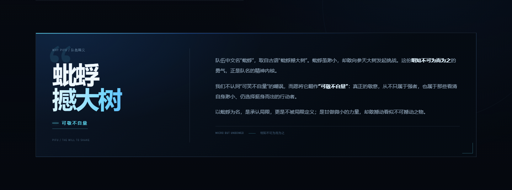
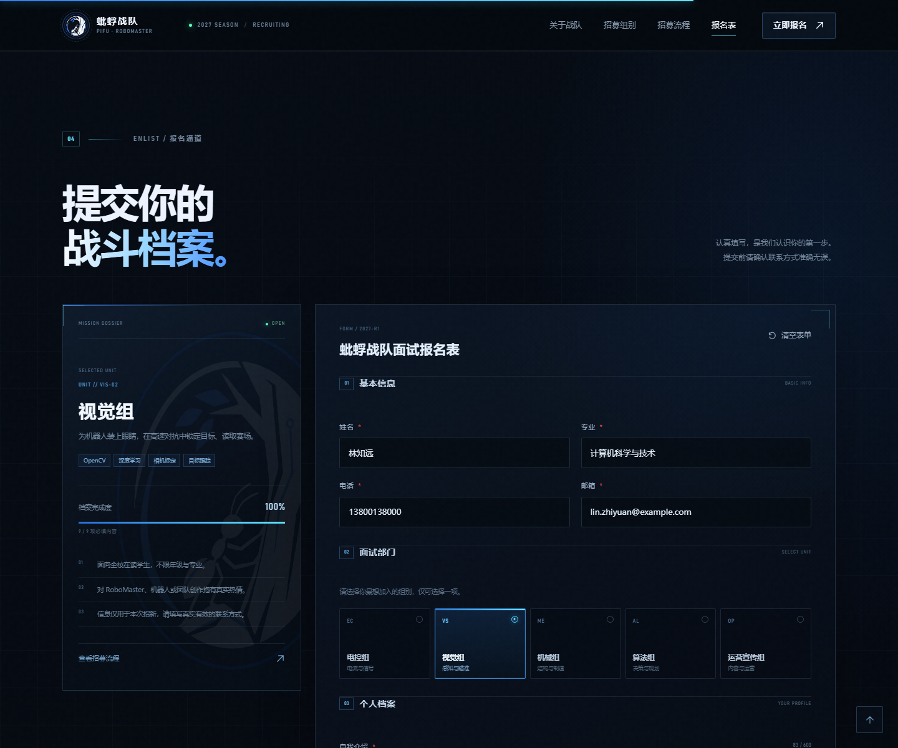

# 蚍蜉战队 · RoboMaster 2027 招新报名页

一个可以直接用 **HBuilderX 打开运行的纯静态招新网页**。页面围绕 RoboMaster 机甲大师的赛场气质设计，包含战队简介、队名释义、五大组别详细介绍、招募流程和完整的面试报名表。

> 蚍蜉战队隶属于河北外国语学院，是学校面向 RoboMaster 机甲大师赛组建的学生科技创新团队，成立于 2026 年。2027 赛季招新开启，期待与你并肩作战。

## 页面预览

| 桌面端 | 移动端 |
| --- | --- |
|  |  |






## 功能清单

- **战队简介与队名释义**：介绍河北外国语学院蚍蜉战队的建队背景，并完整呈现“蚍蜉撼大树”的队名精神。
- **五大面试部门**：电控组、视觉组、机械组、算法组、运营宣传组，每个组别包含工作介绍、三项核心职责与能力关键词，可选择并同步到报名表。
- **Getform / Forminit 一键接入**：提交即写入云端表单后台，支持照片上传、邮件通知与 Google Sheets 同步；未配置时自动退回演示模式。
- **必填报名信息**：姓名、专业、电话、邮箱、面试部门、自我介绍、优势。
- **个人照片上传**：支持点击或拖拽上传，支持 JPG / PNG / WebP，限制 5MB；上传后自动预览、压缩并显示文件信息。
- **优势能力标签**：根据所选部门动态展示能力标签，可多选，作为优势的补充。
- **表单校验**：手机号、邮箱格式校验；空项、字数、照片、隐私同意均有提示，并自动定位到第一个错误项。
- **草稿自动保存**：未提交的内容自动保存在浏览器本地，刷新后可恢复（照片不会写入草稿）。
- **提交反馈**：演示模式下在本地生成报名编号并展示成功档案；可下载 JSON 备份。
- **响应式布局**：桌面、平板、手机三档布局，含移动端折叠菜单。
- **机甲大师视觉元素**：机甲蚁概念机体、HUD 锁定框、战术扫描线、机械网格、队徽、滚动字幕与分区块编号。

## 在 HBuilderX 中运行

1. 打开 HBuilderX，选择 **文件 → 打开目录**，选中本项目文件夹 `pifu-robomaster-recruit`。
2. 在左侧项目管理器中双击 `index.html`。
3. 点击菜单 **运行 → 运行到浏览器**（选择 Chrome / Edge / HBuilderX 内置浏览器即可）。
4. 也可以在系统文件管理器中直接双击 `index.html`，不需要安装依赖或编译。

> 本项目是普通 HTML5 静态项目，不是 uni-app 项目，因此不需要执行 `npm install`，也不需要 `manifest.json`。

## 目录结构

```text
pifu-robomaster-recruit/
├─ index.html                  # 页面结构与全部文案
├─ css/
│  └─ style.css                # 视觉样式、动画与响应式布局
├─ js/
│  └─ app.js                   # 部门联动、表单校验、照片上传、提交逻辑
├─ assets/
│  ├─ team-logo.png            # 蚍蜉战队队徽
│  ├─ mech-ant.svg             # 机甲蚁概念机体插画
│  └─ favicon.png              # 浏览器图标
├─ screenshots/                # 预览截图与自动化测试结果
└─ README.md
```

## 报名数据如何真正提交

默认情况下，页面处于 **前端演示模式**：提交后数据只保存在本机浏览器的 `localStorage` 中，不会发送到服务器，成功弹窗里也有明确提示。

正式收集报名数据时，推荐接入 **Getform / Forminit** 表单后台（免服务器、免费额度 100 次/月）。页面已内置两种接入格式，见下一节。

## 接入 Getform / Forminit（推荐）

> 说明：getform.io 已于 2026 年更名为 **Forminit**（forminit.com），原用户的旧表单仍可使用 getform.io 老地址。本页面两种都支持。

### 第 1 步：注册并创建表单

1. 打开 [forminit.com](https://forminit.com) 注册登录（或使用原 [getform.io](https://getform.io) 账户）。
2. 点击新建表单（Create Form / New Form），名称建议填“蚍蜉战队 2027 招新报名”。
3. 创建后进入 **Form Settings（表单设置）**，将认证模式设为 **Public（公开）**——纯静态页面无法存放密钥，公开模式是前端接入的必要条件。
4. 复制 **Form ID**（形如 `YOUR_FORM_ID` 的一串字符）。

### 第 2 步：把地址填进页面

打开 `js/app.js`，修改顶部 `FORM_CONFIG`：

```js
var FORM_CONFIG = {
  endpoint: "https://forminit.com/f/YOUR_FORM_ID", // 换成你的 Form ID
  fieldMode: "forminit" // "forminit"（新平台，推荐）；"classic"（旧版 getform.io 老表单）
};
```

- 新平台（forminit.com）就用 `fieldMode: "forminit"`：字段会自动按 `fi-{类型}-{名称}` 命名发送。
- 如果你还在用旧版 getform.io 老表单，endpoint 填 `https://getform.io/f/YOUR_FORM_ID`，并把 `fieldMode` 改成 `"classic"`（使用普通字段名）。

### 第 3 步：测试并查收

1. 用 HBuilderX 运行页面，完整填写并提交一次，出现“报名档案已存入战队表单后台”即成功（弹窗中的编号是后台返回的提交 ID）。
2. 登录 [app.forminit.com](https://app.forminit.com)（或旧版后台），在提交列表里应能看到这条记录、全部字段和照片文件。
3. 建议在 Form Settings → Blocks 里把英文字段名改成中文标签（如把 `selfIntro` 显示为“自我介绍”），后台展示更友好。

### 字段映射（forminit 模式）

| 表单字段 | 后台字段名 | 类型 |
| --- | --- | --- |
| 姓名 | `fi-sender-fullName` | 提交者信息 |
| 邮箱 | `fi-sender-email` | 提交者信息 |
| 专业 | `fi-text-major` | 文本 |
| 电话 | `fi-text-phone` | 文本 |
| 面试部门 | `fi-select-department` | 下拉选择 |
| 自我介绍 | `fi-text-selfIntro` | 文本 |
| 优势 | `fi-text-advantages` | 文本 |
| 能力标签 | `fi-checkbox-abilities` | 复选框（多选数组） |
| 来源标识 | `fi-text-source` | 文本，固定 `pifu-2027-web` |
| 个人照片 | `fi-file-photo` | 文件（已压缩为 JPEG，约 10–30KB） |
| 蜜罐（反垃圾） | `_gotcha` | 留空即可 |

### 注意事项

- **公开模式**：前端页面没有服务器存放密钥，Forminit 要求公开模式才能直接从浏览器提交；需要更高限流或私有模式时，可在自己服务器上用 `X-API-KEY` 转发。
- **限流**：公开模式同一 IP 每 5 秒限 1 次提交，测试时请勿连点。
- **文件限制**：Forminit 单次提交上限 25MB；照片已在浏览器端压缩，完全在限制内。
- **反垃圾**：页面已内置 `_gotcha` 蜜罐字段，可在 Forminit 后台开启 Honeypot 防护；如需更严格防刷，可再接入 Turnstile / reCAPTCHA。
- **自动通知**：在后台开启 Email Notifications（新报名邮件提醒）、Google Sheets（报名表实时同步）或 Slack / Discord 通知。
- **file:// 直接打开**：若双击 `index.html` 运行，跨域提交可能被浏览器拦截，建议用 HBuilderX“运行到浏览器”或本地服务器方式访问。

## 修改招新信息

- **页面文案、组别描述、流程**：直接在 `index.html` 中搜索并修改。
- **部门标签、能力标签**：在 `js/app.js` 顶部的 `DEPARTMENTS` 对象中维护。
- **主题色**：在 `css/style.css` 顶部的 `:root` 中修改 `--blue`、`--cyan`、`--red` 等变量。
- **队徽与主视觉**：替换 `assets/team-logo.png`、`assets/mech-ant.svg` 即可。
- **默认招募提示**：如“面向全校在读学生”“信息仅用于本次招新”等文字，请根据战队实际情况调整。

## 校验规则

| 字段 | 规则 |
| --- | --- |
| 姓名 | 2–20 个字符 |
| 专业 | 2–40 个字符 |
| 电话 | 中国大陆 11 位手机号，可带 `+86`、空格或连字符 |
| 邮箱 | 常规邮箱格式 |
| 自我介绍 | 20–600 字 |
| 优势 | 10–300 字 |
| 面试部门 | 必选一个 |
| 个人照片 | 必传，JPG / PNG / WebP，原始文件 ≤ 5MB |
| 隐私同意 | 必须勾选 |

照片会在浏览器内通过 Canvas 压缩为最长边 1400px 的 JPEG（质量约 0.88），再随表单提交。

## 浏览器兼容性

针对现代 Chromium 浏览器设计，已在 **Microsoft Edge 157** 上完成响应式与交互验证：

- 覆盖 320 / 390 / 820 / 1440 宽度的布局检查；
- 桌面端与移动端 55 项交互和布局检查全部通过，详见 `screenshots/test-results.json`；
- 同时验证了直接双击 `index.html`（`file://`）打开时，样式、脚本、图片、队徽与本地存储均可正常工作。

建议使用最新版 Chrome / Edge，或更新到最新版 HBuilderX 的内置浏览器。旧版浏览器可能出现部分装饰性渐变或毛玻璃效果降级，但不影响表单核心流程。

## 说明

- 页面中的队徽与机甲蚁插画为本项目本地素材，不依赖外网图片或字体，断网也能正常显示。
- 如正式上线，请补充真实的战队联系方式、隐私政策与数据保存期限，并在服务器端再次校验提交数据。
